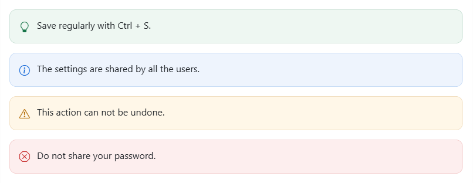

# Writing a documentation

## Files and folders

A documentation is a folder (`doc_dir`). Each Markdown file (`.md`) is a page, each sub-folder is a section.

```text
doc-public/
├── 10__Introduction.md
├── 20__Getting started/
│   ├── 10__Installation.md
│   └── 20__First steps.md
├── 30__Guides/
│   ├── 10__Users.md
│   ├── 20__Settings.md
│   └── assets/
│       └── settings.png
└── 40__FAQ.md
```

- **Order**: files and folders are sorted by name. A number followed by `__` (two underscores: the `_` character twice) sets the order: `10__Introduction.md`. The prefix is not displayed.
- **Names**: the file name, without the prefix and the extension, is the name displayed in the menu. Letters (accents included), numbers, spaces, `_` and `-` can be used.
- **Folders**: each folder has an index page listing its content. Folders named `assets` are not displayed in the menu: they are used to store the media files.

## Markdown

The pages use standard Markdown (Parsedown): headings, lists, links, images, code blocks, tables...

```markdown
# Settings

Open the **Settings** page, then:

1. Choose a language
2. Save
```

## Boxes

Text between `:::type` and `:::` is displayed in a box:

```markdown
:::tip Save regularly with Ctrl + S. :::

:::info The settings are shared by all the users. :::

:::warning This action can not be undone. :::

:::danger Do not share your password. :::
```

Result:



Types: `tip`, `info`, `warning`, `danger`. Any other type is displayed as a neutral box.

A box can contain several paragraphs, lists, links...: write `:::type` and `:::` on their own lines.

```markdown
:::warning
Before deleting a user:

- export their data,
- check their documents.
:::
```

## Task lists

```markdown
- [ ] Export the data
- [x] Check the documents
```

The items are displayed with a checkbox. The reader can check them (check list), nothing is saved.

## Links between pages

Use relative links to the files, with or without the `.md` extension:

```markdown
See [First steps](20__Getting%20started/20__First%20steps.md).
```

In the Markdown links and images, the spaces must be written `%20`: Markdown stops the link at the first space. Accents can be written as is.

### Table of contents and link to a section

On wide screens, the `##` and `###` headings of a page are listed on the right ("On this page"), when the page has at least two of them.


The `##` and `###` headings get an id made from their text (lowercase, without accents, words separated by `-`). Add it after `#` to link to a section:

```markdown
See [the settings](30__Guides/20__Settings.md#user-settings).
```

Here the target is the heading `## User settings`. If two headings have the same text, the second one gets `-2` (`#user-settings-2`).

## Images, videos and files

Media files are stored in the documentation folder, next to the pages or in an `assets` folder, and linked with relative paths:

```markdown

```

```html
<video width="100%" controls>
  <source src="assets/presentation.mp4" type="video/mp4">
</video>
```

Allowed file types: `pdf`, `jpg`, `jpeg`, `png`, `gif`, `webp`, `mp4`, `webm`.

An image can be used on several pages: link it from another folder with a relative path, for example `` (`..` : parent folder). The paths can not go outside the documentation folder.

As for the links, write the spaces `%20` in the Markdown images: ``. In the HTML tags (`<video>`, `<source>`...), the spaces can be written as is.

## HTML

Pages can contain HTML. It is cleaned before being displayed (allow list), so a page can not run code:

- **Kept**: text formatting, headings, lists, links, images, videos and audios (`video`, `audio`, `source`, `track`), tables, `details` / `summary`, `figure`, `kbd`, `mark`...
- **Removed**: `script`, `style`, `iframe`, `object`, `embed`, `form`, `svg`, event attributes (`onclick`...), `style` attributes, `javascript:` and `data:` URLs.
- Links opened in a new tab get `rel="noopener noreferrer"`.

## Editing in the browser

> [!WARNING]
> The edition writes the files on the server: pages saved, created or deleted, media files sent or deleted.
>
> If the documentation is versioned (with Git for example), these changes are only on the server. Commit and push them to the repository, otherwise they can be lost at the next deployment (`git pull`, `git reset`, new release...) or be in conflict with the changes made elsewhere.

Users with the `edit_security` role see a menu (`⋯`) at the top of the pages, folders and documentation home:

- **Edit** the page,
- **New page** / **New folder**: name and position (by default after the last one), created in the current folder. A new page opens in the editor,
- **Delete the page**, or **Delete the folder** when it is empty (or only contains an empty `assets` folder). The media files of a deleted page are kept.

The edit page has:

- the page name and position (used to rename the file),
- a Markdown editor: the file is edited as is, it is never converted,
- three displays: **Write / Preview** (the Markdown and the preview side by side, the preview is updated while typing, on wide screens), **Write** and **Preview**. The last display chosen is kept. A click on a text or an image of the preview places the cursor on the same text in the Markdown (double click in the Preview display),
- a toolbar: bold, italic, headings (paragraph, levels 1 to 5), lists, task list, quote, link, code, table (size chosen on a grid), and the `tip`, `info`, `warning`, `danger` boxes. Shortcuts: `Ctrl + B`, `Ctrl + I`, `Ctrl + K` (link). `Enter` continues a list, `Tab` / `Shift + Tab` indent the lines,
- a **link** window: type an address, or choose a page or a folder of the documentation (searchable list). The link is written relative to the page,
- a **Media** window: browse the folders of the documentation, send images, videos and PDF files to the `assets` folder of the folder displayed, and insert a file of any folder (the path is written relative to the page). The files of the `assets` folder and the ones stored directly in the folder are listed. The trash icon deletes a file: if pages use it, they are listed and a second confirmation is asked. Files can also be dropped or pasted (screenshot) in the editor: they are sent to the `assets` folder of the page. The file names are simplified (`Screen capture.png` → `screen-capture.png`), an existing file is never replaced,
- `Ctrl + S` to save. A warning is displayed when leaving the page with unsaved changes.

The toolbar updates the element of the cursor instead of adding a new one:

- **Link**: the window opens with the text and the address of the link, to change or remove it (the text is kept).
- **Media**: on an image, a video or a link to a file, the window opens in its folder and the file chosen replaces it (the text of the image is kept).
- **Boxes**: another type changes the type of the box, the same type removes the box (its content is kept). Without selection, the paragraph of the cursor goes in the box.
- **Table**: the grid resizes the table, the content of the cells is kept (confirmation before deleting cells with content).
- **Bold, italic, code, code block**: removed when the cursor is inside. Without selection, applied to the word (or the paragraph for a code block) of the cursor.
- **Headings, lists, quote**: the lines change of type.

A page can not be renamed or created with the name of an existing page or folder. The maximum size of the media files is set by [`upload_max_size`](30__Configuration.md#upload_max_size).
